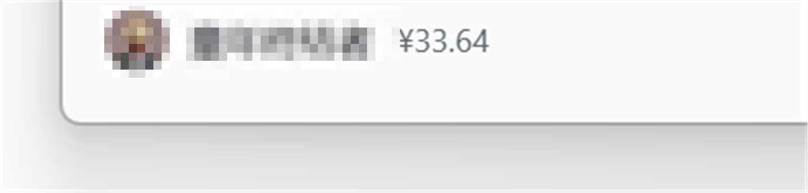

# dsh-balance-chip

> Show your **DeepSeek topped-up balance** right after the sidebar nickname in DeepSeek Harness.

[GitHub](https://github.com/baoshudedaxigua/dsh-balance-chip) · [Gitee](https://gitee.com/shadow0101/dsh-balance-chip) · [中文](README.md) · [MIT](LICENSE)



<p align="center"><sub>Avatar and nickname are masked; the balance is read live from the DeepSeek account.</sub></p>

[中文](README.md) | English

## What it does

```
[avatar] your-name  ¥33.64
         └ nickname ┘  └ topped-up balance
```

- Lives inside the bottom-left account launcher, **immediately after the nickname** — no extra row, no layout shift.
- Shows the **topped-up balance** only; hover to see the granted-balance breakdown.
- Hides itself when the sidebar is collapsed, and when no DeepSeek account is signed in.
- Refreshes every 60 seconds, and immediately when the window regains focus/visibility.
- Multiple currencies (CNY / USD) are shown side by side; amounts use the same formatting as the official account page.
- Presentation only: it stores no API key and adds no new HTTP surface.

## Compatibility

| Environment | Status |
| --- | --- |
| DeepSeek Harness `0.2.1-rc.5` (Windows desktop) | ✅ verified |
| DeepSeek Harness `0.2.1-rc.5` (web / `dsh web`) | ✅ verified |
| DSH `0.2.2+` | ⚠️ untested (a rewritten sidebar account DOM would need an adapter) |

The plugin relies on the official `remote.account` service shipped with `@deepseek-ai/dsh-client-ui-settings-account`, i.e. the same number shown under **Settings → Account → Topped-up balance**.

## Install

### Desktop app (Windows, profile `desktop`)

The desktop profile is owned by the Electron app and the `dsh plugin` CLI refuses it, so install it with the script or by hand.

**A. Script (recommended)**

```powershell
# clone this repository first (GitHub or Gitee, identical content)
git clone https://github.com/baoshudedaxigua/dsh-balance-chip.git D:\dsh-balance-chip
powershell -NoProfile -ExecutionPolicy Bypass -File D:\dsh-balance-chip\scripts\install-desktop.ps1
```

Then **fully quit** DeepSeek Harness (tray icon → right click → Quit) and reopen it.

The script copies the plugin into `%USERPROFILE%\.dsh\profiles\desktop\node_modules\dsh-balance-chip` and adds `dsh-balance-chip` to the profile's `dependencies` and `dsh.profile.bundles` (the original `package.json` is backed up first). Pass `-ProfileDir` for a non-default DSH home, or `-Uninstall` to remove it.

**B. Manual**

1. Copy this directory to `%USERPROFILE%\.dsh\profiles\desktop\node_modules\dsh-balance-chip`.
2. In `%USERPROFILE%\.dsh\profiles\desktop\package.json`: add `"dsh-balance-chip": "link:<absolute path>"` to `dependencies`, and `"dsh-balance-chip"` to `dsh.profile.bundles`.
3. Fully quit and reopen DeepSeek Harness.

### Web / other profiles

```powershell
dsh plugin --profile web add "link:D:\dsh-balance-chip"
# or straight from git (lib/ is committed, no build step needed):
dsh plugin --profile web add "github:<your-name>/dsh-balance-chip"
```

Restart `dsh web` afterwards.

## How it works

1. A client-only plugin (`dsh.client`, `platform: web`); the host half is an empty `apply()` that only makes DSH discover and serve the browser bundle.
2. On start it calls the official account Remote `getBalance` — the same host method behind the account settings card.
3. It appends a read-only `span` after the nickname `span` inside the sidebar account button (`<button data-signed-out>`).
4. A `MutationObserver` re-attaches the chip after React re-renders, sign-in changes, or sidebar collapse.
5. It refreshes every 60 s, on focus, and on visibility change; unload removes node, style, observers and timers.

Why DOM append instead of a slot: the sidebar footer's `settings.launcher` is a **single** slot already occupied by the official account entry, and official DSH exposes no additive slot inside that entry. The plugin only appends a presentational span; it never replaces or shadows official UI.

## FAQ

- **Nothing appears** — make sure the app was fully quit and reopened, and that the profile manifest contains the two `dsh-balance-chip` entries.
- **No balance although Settings shows one** — the plugin hides itself when no account is signed in. Press `F12` in the desktop app and look for `dsh-balance-chip` errors.
- **Broke after a DSH upgrade** — DSH may have changed the account DOM; please open an issue with the DSH version.
- **Does it leak my API key?** No — it never reads or stores credentials; the balance comes from DSH's existing account RPC.
- **Multiple accounts** — it follows the signed-in account and updates after a switch.

## Development

- `npm run check` — syntax check + client-bundle contract self-test (no dependencies needed).
- Local iteration: `dsh plugin --profile web add "link:<this dir>"`, then restart `dsh web` and refresh the page.

## License

[MIT](LICENSE). Community plugin, not affiliated with DeepSeek.
