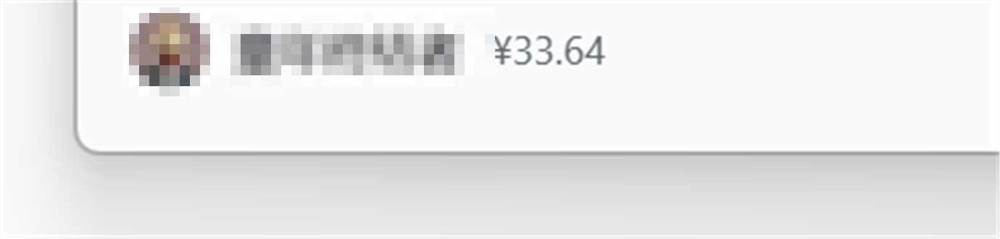

# dsh-balance-chip

> 把 **DeepSeek 充值余额**直接显示在 DeepSeek Harness 左下角的昵称后面。

[GitHub](https://github.com/baoshudedaxigua/dsh-balance-chip) · [Gitee](https://gitee.com/shadow0101/dsh-balance-chip) · [English](README.en.md) · [MIT](LICENSE)



<p align="center"><sub>头像与昵称已打码；余额实时读取自 DeepSeek 账号</sub></p>

## 它做什么

```
[头像] 童年终结者  ¥33.64
        └─ 昵称 ─┘  └ 充值余额
```

- 常驻在侧边栏底部账号入口里，**紧挨昵称**，不额外占一行、不挡内容
- 只显示**充值余额**（Platform 的 normal wallet）；鼠标悬停可看到赠金余额明细
- 侧边栏收起（窄栏）时自动隐藏；未登录 DeepSeek 账号时不显示
- 每 60 秒刷新一次；切回窗口 / 页面重新可见时也会立刻刷新
- 多币种（CNY / USD）依次并列显示；金额格式与官方账号页一致（两位小数、千分位、不足一分显示 `<¥0.01`）
- 纯前端展示：不保存 API Key、不新增任何请求入口

## 兼容性

| 环境 | 状态 |
| --- | --- |
| DeepSeek Harness `0.2.1-rc.5`（Windows 桌面版） | ✅ 已验证 |
| DeepSeek Harness `0.2.1-rc.5`（Web 版 / `dsh web`） | ✅ 已验证 |
| DSH `0.2.2+` | ⚠️ 未验证（官方若重写侧边栏账号入口的 DOM，需要适配） |
| Node.js / 操作系统 | 插件本身不跑 Node 代码；桌面版、Web 版通用 |

> 插件依赖官方账号能力提供的 `remote.account` 服务（`@deepseek-ai/dsh-client-ui-settings-account` 自带）。只要你的 DSH 能正常显示「设置 → 账号 → 充值余额」，本插件就能读到同一个数字。

## 安装

### 桌面版（Windows 桌面应用，profile 名为 `desktop`）

> 桌面版 profile 由 Electron 独占，`dsh plugin --profile desktop ...` 会被 CLI 拒绝，所以用下面的脚本安装。

**方式 A：脚本（推荐）**

1. 先把本仓库克隆到本地（GitHub 或 Gitee 任选，两边内容一致），例如 `D:\dsh-balance-chip`：

```powershell
git clone https://github.com/baoshudedaxigua/dsh-balance-chip.git D:\dsh-balance-chip
# 国内网络可用 Gitee：
# git clone https://gitee.com/shadow0101/dsh-balance-chip.git D:\dsh-balance-chip
```
2. 打开 PowerShell 执行：

```powershell
powershell -NoProfile -ExecutionPolicy Bypass -File D:\dsh-balance-chip\scripts\install-desktop.ps1
```

3. **完全退出** DeepSeek Harness（右下角托盘图标 → 右键 → **退出应用**），再重新打开。

脚本做的事：把插件复制到 `%USERPROFILE%\.dsh\profiles\desktop\node_modules\dsh-balance-chip`，并在 `profiles\desktop\package.json` 的 `dependencies` 和 `dsh.profile.bundles` 里各加一项（原文件会先备份成 `package.json.bak-<时间戳>`）。

可用参数：

```powershell
# 自定义 profile 目录（默认 %USERPROFILE%\.dsh\profiles\desktop）
... -File scripts\install-desktop.ps1 -ProfileDir "D:\other-home\.dsh\profiles\desktop"

# 卸载
... -File scripts\install-desktop.ps1 -Uninstall
```

**方式 B：手动**

1. 把仓库目录复制到 `%USERPROFILE%\.dsh\profiles\desktop\node_modules\dsh-balance-chip`
2. 编辑 `%USERPROFILE%\.dsh\profiles\desktop\package.json`：
   - `dependencies` 增加 `"dsh-balance-chip": "link:<仓库绝对路径>"`
   - `dsh.profile.bundles` 末尾增加 `"dsh-balance-chip"`
3. 完全退出并重新打开 DeepSeek Harness

### Web 版 / 其它 profile

```powershell
# 本地目录（推荐开发时用）
dsh plugin --profile web add "link:D:\dsh-balance-chip"

# 或直接从 Git 仓库安装（lib/ 已随仓库提交，无需构建）
dsh plugin --profile web add "github:<你的用户名>/dsh-balance-chip"
```

装完重启 `dsh web` 即可。

> 为什么桌面版要手动安装：Desktop profile 的名称是保留的，DSH CLI 明确禁止外部命令启动/修改它，插件安装只能由应用自身或手工完成。

## 更新 / 卸载

- 更新：覆盖 `node_modules\dsh-balance-chip` 的文件（或重新跑一次安装脚本），然后重启应用
- 卸载：`scripts\install-desktop.ps1 -Uninstall`，重启应用
- Web 版：`dsh plugin --profile web remove dsh-balance-chip`

## 工作原理

1. 插件以纯客户端插件（`dsh.client`，`platform: web`）加载，Host 半是空实现，只用来让 DSH 发现并下发前端 bundle。
2. 启动后调用官方账号 Remote 的 `getBalance`（与「设置 → 账号」余额卡片同一个 Host 方法），拿到充值钱包与赠金钱包。
3. 在侧边栏底部的账号入口 `<button data-signed-out>` 内、昵称 `span` 之后追加一个只读 `span` 显示余额。
4. 用 `MutationObserver` 监听账号入口重渲染 / 登录状态切换 / 侧栏折叠，保证 React 重绘后它还在。
5. 每 60 秒、窗口重新可见、窗口获得焦点时刷新；卸载时移除节点、样式、监听器和定时器。

为什么用 DOM 追加而不是官方 Slot：侧边栏底部的 `settings.launcher` 是 **single** 槽位（只能有一个占用者，默认就是官方账号入口），无法在其内部"昵称之后"插入独立内容；官方也没有提供账号入口内的增量槽位。因此本插件只在官方节点末尾追加一个展示型 span，不替换、不覆盖任何官方 UI。

## 常见问题

**安装完没看到？**
先确认已**完全退出**应用再打开（关闭窗口可能只是收进托盘）；然后确认 `profiles\desktop\package.json` 里两处都写上了 `dsh-balance-chip`。

**显示不出来，但账号设置里有余额？**
请确认已登录 DeepSeek 账号（未登录时插件按设计隐藏）。桌面版可按 `F12` 打开开发者工具，Console 里查找 `dsh-balance-chip` 相关报错。

**升级 DSH 后不见了？**
DSH 若改写了侧边栏账号入口的 DOM，本插件需要同步适配。请提 Issue 并附上 DSH 版本号。

**会不会泄露我的 API Key？**
不会。插件不读取、不保存任何密钥；它通过 DSH 已有的账号 RPC 取余额数字，密钥始终在 Host 侧。

**支持多账号 / 切换账号吗？**
跟随当前登录账号，切换账号后会自动显示新账号余额。

## 开发

```
dsh-balance-chip/
├── package.json          # dsh.bundle / dsh.client 声明
├── cordis.patch.yml      # Host 侧挂载行
├── lib/
│   ├── index.js          # Host 半（空实现）
│   └── client.js         # 浏览器半（手写 CJS bundle）
├── scripts/
│   ├── install-desktop.ps1
│   └── check-bundle.mjs  # 离线自检
└── docs/
    └── screenshot.png
```

- 自检：`npm run check`（语法检查 + bundle 契约自检，不需要安装依赖）
- 本地联调（Web 版热加载）：`dsh plugin --profile web add "link:<本目录>"` 后重启 `dsh web`，改 `lib/client.js` 再刷新页面即可
- 桌面版每次新增/删除插件都需要重启应用；仅修改 client 代码时重启进程后刷新页面

## 许可证

[MIT](LICENSE)。与 DeepSeek 官方无关，是社区插件。
